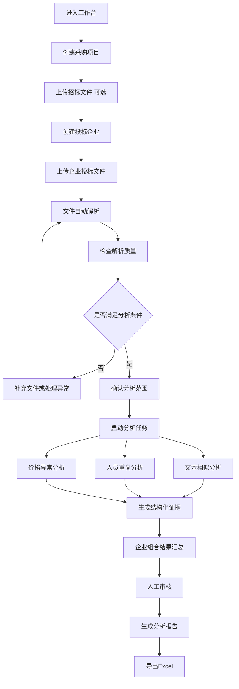
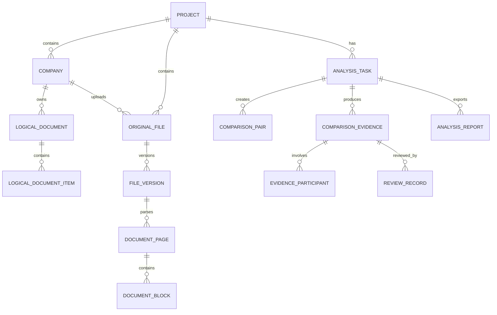

# 投标文件智能比对与风险分析平台 V1.0 产品需求规格说明书（PRD）

**项目名称：** 投标文件智能比对与风险分析平台  
**适用业务：** 贵州银行集中采购项目评标监督  
**版本：** V1.0  
**文档状态：** 产品设计稿  
**产品定位：** 面向采购监督业务，对同一采购项目内多家投标企业提交的投标文件进行解析、交叉比对和异常线索识别，辅助监督人员发现疑似围标串标风险，并通过人工审核形成可追溯的分析结果和报告。

---

# 一、项目背景与建设目标

## 1.1 项目背景

在银行集中采购活动中，同一采购项目通常会有多家企业参与投标。投标企业需要提交技术标、商务标、报价文件以及相关资质材料。

在传统监督工作中，工作人员需要人工阅读多家企业的投标文件，并通过人工查找、复制、比对等方式，判断不同企业之间是否存在异常情况。

这种方式存在几个问题：

1. **文件数量多，人工检查成本高。** 多家企业的投标文件可能包含大量页面，逐份阅读和交叉比对耗时较长。
2. **异常内容不容易发现。** 不同企业可能存在相同或高度相似的文字表述、人员信息和报价规律，仅依靠人工检查容易遗漏。
3. **正常相似内容容易产生误报。** 不同企业按照同一份招标文件编制投标材料，出现相同的技术参数、格式条款和响应内容是正常现象。
4. **异常证据不容易追溯。** 发现相似内容后，还需要回到原始文件中寻找对应页码和具体位置。
5. **分析结果缺乏统一管理。** 不同项目的文件、比对结果和人工审核意见需要形成结构化记录，便于后续查询和复核。

因此，需要建设投标文件智能比对与风险分析平台，通过自动化解析、文本比对、人员信息识别和报价异常分析，帮助监督人员更高效地发现异常线索。

## 1.2 建设目标

V1.0 重点实现以下目标：

- 支持创建采购项目，并在项目内管理招标文件和投标企业。
- 支持一家投标企业上传多份投标文件，形成企业级逻辑投标文件。
- 自动解析 PDF、Word 等文件，提取文本并保留原始文件、页码和内容位置映射。
- 对同一项目内的不同投标企业进行两两交叉比对。
- 识别不同投标企业之间的文本相似、人员重复和报价异常。
- 支持招标文件公共内容排除，减少正常响应内容带来的误报。
- 将识别出的异常内容形成结构化证据，支持原文定位和人工审核。
- 生成 Excel 分析报告，支持项目级结果汇总和分类明细导出。
- 保留分析任务、算法版本、审核记录和操作日志，确保结果可追溯。

## 1.3 V1.0 产品定位

V1.0 是一个**项目级投标文件智能比对和风险辅助分析工具**。

核心业务对象是采购项目，核心分析对象是项目内参与投标的企业，核心输出是异常证据。

产品不负责自动认定企业存在围标串标行为，而是通过算法识别疑似异常情况，提供可核查的证据，辅助工作人员进行人工判断。

## 1.4 V1.0 不建设的内容

以下功能不纳入 V1.0：

1. 跨采购项目的投标文件相似度比对。
2. 跨项目企业异常关联分析。
3. 企业历史投标行为画像和风险预测。
4. 自动认定围标串标或自动生成违规结论。
5. 企业之间的关系图谱。
6. 复杂的企业工商信息自动采集。
7. 多机构、多银行之间的数据共享。
8. 复杂的工作流审批引擎。
9. 自动从外部采购平台抓取招投标数据。

V1.0 只处理用户明确创建的项目及其上传文件。

---

# 二、用户角色与使用场景

## 2.1 用户角色

V1.0 暂按以下角色设计。

### 角色一：系统管理员

主要负责系统运行和基础配置。

权限包括：

- 用户账号管理。
- 角色和权限配置。
- 项目数据权限配置。
- 检测规则配置。
- 文件解析服务配置。
- 系统运行状态查看。
- 操作日志查看。

### 角色二：项目分析人员

主要负责项目资料准备、文件解析和比对分析。

权限包括：

- 创建项目。
- 编辑项目资料。
- 添加招标文件。
- 添加投标企业。
- 上传和管理投标文件。
- 查看解析结果。
- 启动分析任务。
- 查看比对结果。
- 导出分析报告。

### 角色三：风险审核人员

主要负责对系统识别出的异常证据进行人工复核。

权限包括：

- 查看授权项目的比对结果。
- 查看异常证据及原始文件。
- 确认异常线索。
- 排除正常情况。
- 标记待进一步核查。
- 填写审核意见。
- 查看历史审核记录。

同一用户可以根据实际授权同时拥有多个角色。

## 2.2 核心使用场景

### 场景一：创建采购项目并上传文件

工作人员创建一个采购项目，上传本次采购的招标文件，然后创建多家投标企业，为每家企业上传对应的投标文件。

### 场景二：文件解析与资料确认

系统自动解析文件，提取正文、页码和报价信息。

工作人员检查解析情况，确认哪些企业、哪些文件可以参与分析。

### 场景三：启动智能比对

工作人员手动启动分析任务。

系统对所有参与分析的企业进行两两交叉比对，执行文本相似、人员重复和价格异常分析。

### 场景四：查看异常证据

系统生成企业组合的分析结果。

工作人员选择企业组合，查看双方原始文件和异常证据，定位具体页码及相似内容。

### 场景五：人工审核和导出报告

工作人员逐条审核异常证据，记录确认、排除或待进一步核查的意见，最终导出 Excel 报告。

---

# 三、整体产品架构

## 3.1 一级菜单设计

V1.0 建议采用以下系统级导航：

1. 工作台
2. 项目管理
3. 风险管理
4. 系统管理

其中，项目管理是整个系统的核心。

企业管理和标书档案库暂不作为独立一级菜单。企业信息和标书文件先在项目内部管理，避免过早建设独立的数据资产体系。

## 3.2 系统级页面与项目级页面

### 系统级页面

| 一级菜单 | 主要功能 |
|---|---|
| 工作台 | 全局项目统计、待办事项、最近项目、最近任务 |
| 项目管理 | 创建项目、查询项目、查看项目详情 |
| 风险管理 | 汇总所有授权项目中的异常证据，集中审核 |
| 系统管理 | 用户权限、检测规则、操作日志、服务配置 |

### 项目内部页面

每个项目保留以下功能：

| 页面 | 主要功能 |
|---|---|
| 项目概览 | 项目基本情况、文件统计、分析状态、下一步操作 |
| 文件管理 | 招标文件、投标企业、投标文件管理 |
| 解析中心 | 文件解析进度、解析质量、解析结果 |
| 比对分析 | 分析范围确认、分析配置、启动分析 |
| 比对结果 | 企业组合、异常证据、三栏比对、人工审核 |
| 分析报告 | Excel 报告导出、历史分析任务 |

## 3.3 核心业务流程

---

# 四、功能需求详细设计

# 4.1 工作台

**优先级：P0**

## 4.1.1 功能定位

工作台是用户登录后的默认首页。

它不负责具体的文件分析，而是展示当前用户有权限查看的项目、分析任务和风险审核情况，帮助用户快速找到需要处理的业务。

## 4.1.2 页面布局

建议分为五个区域。

### A. 全局统计卡片

展示以下指标：

| 指标 | 统计口径 |
|---|---|
| 项目总数 | 当前用户有权限查看的项目总数 |
| 进行中项目 | 未归档且尚未完成业务处理的项目 |
| 已完成分析任务 | 状态为完成的分析任务数量 |
| 异常证据总数 | 当前权限范围内的有效证据数量 |
| 待审核证据 | 当前尚未完成审核的证据数量 |

所有统计均按照当前用户权限范围计算。

点击卡片可以跳转到对应列表，并自动应用相应筛选条件。

### B. 待办事项

展示需要用户处理的事项：

- 项目文件解析失败。
- 项目存在部分解析成功文件。
- 项目尚未确认分析范围。
- 分析任务执行失败。
- 存在待审核异常证据。
- 报告尚未导出或完成业务确认。

每条待办展示：

- 待办类型。
- 所属项目。
- 具体事项。
- 创建时间。
- 当前状态。
- 处理入口。

点击后直接进入相关项目或证据详情。

### C. 最近项目

展示最近访问或最近更新的项目。

字段：

- 项目名称。
- 项目编号。
- 项目状态。
- 投标企业数量。
- 最近分析时间。
- 待审核证据数量。
- 操作入口。

### D. 最近分析任务

展示最近执行的分析任务：

- 任务编号。
- 所属项目。
- 参与企业数量。
- 创建时间。
- 完成时间。
- 执行状态。
- 算法版本。
- 查看任务入口。

### E. 风险统计

展示当前权限范围内的风险概况：

- 文本相似证据数量。
- 人员重复证据数量。
- 价格异常证据数量。
- 高、中、低风险分布。
- 待审核、已确认、已排除、待进一步核查的数量。

统计口径必须明确：同一证据不能因在不同页面出现而重复计数。

## 4.1.3 交互规则

1. 工作台统计数据应支持点击跳转。
2. 待办事项只展示当前用户有权限处理的内容。
3. 已完成、已归档项目可以从最近项目中查看，但不应被错误统计为进行中项目。
4. 页面数据应支持刷新。
5. 统计结果应与项目列表、风险管理列表保持一致。

## 4.1.4 验收标准

- 用户登录后默认进入工作台。
- 统计数字与后台数据一致。
- 点击待办可以准确定位到对应事项。
- 无权限项目的数据不能通过工作台统计或列表泄露。

---

# 4.2 项目管理

**优先级：P0**

## 4.2.1 功能定位

项目管理是系统的核心业务入口。

每个采购项目独立管理自己的招标文件、投标企业、投标文件、解析任务、分析任务和风险证据。

## 4.2.2 项目列表

### 页面字段

| 字段 | 说明 |
|---|---|
| 项目名称 | 用户填写 |
| 项目编号 | 系统自动生成或用户填写 |
| 采购类型 | 可选分类 |
| 项目状态 | 准备中、分析中、待审核、已完成、已归档 |
| 投标企业数量 | 当前项目企业数量 |
| 文件数量 | 当前项目有效文件数量 |
| 分析任务数量 | 当前项目历史分析任务数量 |
| 待审核证据 | 当前项目未完成审核的证据数量 |
| 创建人 | 项目创建用户 |
| 创建时间 | 项目创建时间 |
| 最近更新时间 | 最近一次有效修改时间 |

### 查询条件

- 项目名称。
- 项目编号。
- 项目状态。
- 创建时间。
- 创建人。

### 页面操作

- 新建项目。
- 查看项目。
- 编辑项目。
- 归档项目。
- 恢复归档项目（需要授权）。

## 4.2.3 创建项目

必填字段：

- 项目名称。
- 项目编号（若由系统生成，则不要求用户填写）。

选填字段：

- 采购单位。
- 采购部门。
- 项目类型。
- 项目负责人。
- 项目说明。
- 采购时间。
- 备注。

创建成功后进入项目概览页面。

## 4.2.4 项目状态

建议采用以下状态：

| 状态 | 说明 |
|---|---|
| 准备中 | 项目已创建，正在准备文件 |
| 分析中 | 至少存在一个正在执行的分析任务 |
| 待审核 | 已产生分析结果，存在待审核证据 |
| 已完成 | 当前分析和人工审核工作已完成 |
| 已归档 | 项目已归档，不再进行常规编辑 |

状态变化由系统根据项目资料和任务情况更新，但项目负责人可以在满足条件时执行归档操作。

需要注意：分析任务完成不代表项目业务已完成。存在待审核证据时，项目应显示待审核状态。

## 4.2.5 项目归档

归档前提示：

- 项目是否存在执行中的分析任务。
- 是否存在未审核证据。
- 是否存在尚未导出的报告。

归档后：

- 默认禁止新增、删除、替换文件。
- 禁止修改已完成分析任务的历史结果。
- 保留查看、导出和历史追溯能力。
- 经授权可以恢复归档。

---

# 4.3 项目概览

**优先级：P0**

## 4.3.1 功能定位

项目概览是进入具体项目后的首页。

核心作用是让用户知道项目目前准备得怎么样、分析进行到哪一步，以及下一步应该做什么。

## 4.3.2 页面布局

### A. 项目基本信息

展示：

- 项目名称。
- 项目编号。
- 创建时间。
- 项目负责人。
- 项目状态。
- 最近分析任务。

右上角提供：

- 编辑项目。
- 归档项目。

### B. 项目统计卡片

展示：

- 投标企业数量。
- 原始文件数量。
- 已解析文件数量。
- 可参与分析企业数量。
- 待处理异常数量。

### C. 下一步操作推荐

根据项目当前状态展示一个明确的主要操作。

例如：

| 当前情况 | 推荐操作 |
|---|---|
| 尚未上传投标企业文件 | 前往文件管理 |
| 文件尚未解析 | 前往解析中心 |
| 部分文件解析失败 | 检查解析异常 |
| 文件已解析但未确认分析范围 | 前往比对分析 |
| 尚未执行分析 | 启动分析任务 |
| 已产生结果且存在待审核证据 | 查看比对结果 |
| 证据已审核 | 查看分析报告 |

系统只推荐操作，不应在用户没有确认的情况下自动启动分析。

### D. 项目准备情况

展示：

- 招标文件上传状态。
- 投标企业数量。
- 文件上传情况。
- 文件解析情况。
- 分析任务情况。
- 风险审核情况。

### E. 最近分析任务

展示当前项目最近的若干条任务：

- 任务编号。
- 参与企业数量。
- 创建时间。
- 完成时间。
- 任务状态。
- 查看任务。

---

# 4.4 文件管理

**优先级：P0**

## 4.4.1 功能定位

文件管理负责项目内所有原始文件的管理。

文件管理分为两个区域：

1. 招标文件。
2. 投标企业及其投标文件。

核心原则是：**原始文件独立保存，企业级投标文件通过逻辑组合形成，不物理合并 PDF。**

## 4.4.2 招标文件管理

### 功能说明

招标文件是可选上传内容，用于识别投标文件中由招标要求导致的正常相似内容。

### 页面字段

- 文件名称。
- 文件类型。
- 文件大小。
- 上传时间。
- 文件版本。
- 解析状态。
- 页数。
- 操作。

### 支持操作

- 上传招标文件。
- 查看原始文件。
- 重新解析。
- 替换文件。
- 删除文件。

### 业务规则

1. 一个项目 V1.0 默认只使用一个有效招标文件版本作为当前分析基准。
2. 替换招标文件后，旧版本仍需保留历史记录。
3. 招标文件解析失败时，不允许在没有明确提示的情况下执行公共内容排除。
4. 未上传招标文件时，系统仍可进行其他维度分析，但文本相似结果不执行招标文件排除。
5. 招标文件内容不能直接作为投标企业的普通投标文件参与企业间比较。

## 4.4.3 投标企业管理

### 添加企业

采用先创建企业、再上传文件的方式。

企业信息：

| 字段 | 是否必填 | 说明 |
|---|---|---|
| 企业名称 | 必填 | 本项目中的投标企业名称 |
| 统一社会信用代码 | 选填 | 用于身份辅助识别 |
| 联系人 | 选填 | 项目业务信息 |
| 备注 | 选填 | 其他说明 |
| 是否参与分析 | 必填 | 默认参与，可手动取消 |

单个项目最多支持 20 家投标企业。

### 企业列表

展示：

- 企业名称。
- 文件数量。
- 文件总页数。
- 文件解析状态。
- 是否参与分析。
- 逻辑标书状态。
- 操作入口。

### 企业操作

- 添加企业。
- 编辑企业。
- 删除企业。
- 管理文件。
- 查看逻辑标书。
- 设置是否参与分析。

删除企业前，需要检查其是否已被历史分析任务引用。

如果已经参与分析，不应直接物理删除，应采用停用或软删除方式保留历史关系。

## 4.4.4 投标文件上传

每家企业可以上传多份文件。

V1.0 支持：

- PDF。
- Word / DOCX。
- WPS 文档（具体格式和解析兼容性需要在技术验证后确定）。

上传规则：

1. 单个 PDF 文件不超过 500MB。
2. 单项目最多 20 家投标企业。
3. 每家企业可以上传多份文件。
4. 文件名称不得作为唯一标识。
5. 同名文件允许存在，但必须能够区分。
6. 文件上传后生成唯一文件 ID。
7. 保存原始文件，不直接修改用户上传的内容。

### 文件列表字段

- 文件名称。
- 文件类型。
- 文件大小。
- 页数。
- 上传时间。
- 上传人。
- 文件版本。
- 解析状态。
- 操作。

### 文件操作

- 查看。
- 下载（根据权限）。
- 重新解析。
- 替换。
- 删除。
- 调整顺序。

## 4.4.5 文件逻辑排序

用户可以手动调整同一企业下多份文件的顺序。

例如：

1. 商务标.pdf
2. 技术标.pdf
3. 报价文件.pdf
4. 企业资质.pdf

系统按照用户设置的顺序形成逻辑投标文件。

调整顺序不改变原始文件内容，只影响逻辑文档的组织顺序。

## 4.4.6 逻辑投标文件

逻辑投标文件是企业级分析对象。

假设甲公司上传了三个文件：

- 商务标.pdf
- 技术标.pdf
- 报价文件.pdf

系统不需要将三个 PDF 合并成一个新 PDF，而是建立一个逻辑文档：

甲公司逻辑投标文件：

| 顺序 | 原始文件 | 逻辑页码范围 |
|---|---|---|
| 1 | 商务标.pdf | 1—20 |
| 2 | 技术标.pdf | 21—60 |
| 3 | 报价文件.pdf | 61—65 |

逻辑页码仅用于组织企业级内容。

实际证据必须保留：

- 原始文件名称。
- 原始文件 ID。
- 原始 PDF 物理页码。
- 文件内部打印页码（如果可识别）。
- 文本内容位置。
- 逻辑文档中的位置。

原始 PDF 物理页码与文档打印页码必须分开保存，避免页码错位。

## 4.4.7 文件替换与删除

文件发生替换、删除或排序变化时：

1. 原始文件历史版本需要保留。
2. 当前逻辑文档版本发生变化。
3. 已有分析任务的文件快照不应被覆盖。
4. 相关历史结果保留，并标记为基于旧版本生成。
5. 新分析任务使用最新文件版本。
6. 对已产生的结果展示“当前资料已发生变化”的提示。

---

# 4.5 解析中心

**优先级：P0**

## 4.5.1 功能定位

解析中心负责把上传的原始文件转换为可分析、可定位、可追溯的结构化文本。

解析质量直接决定后续比对结果质量，因此解析中心不仅展示任务状态，还需要提供人工检查能力。

## 4.5.2 解析任务范围

解析对象包括：

- 招标文件。
- 各投标企业的原始文件。

解析任务可以：

- 单文件解析。
- 单企业文件批量解析。
- 项目内全部文件解析。

默认上传后自动创建解析任务，但用户可以手动触发重新解析。

## 4.5.3 解析状态

| 状态 | 说明 |
|---|---|
| 待解析 | 文件尚未开始处理 |
| 解析中 | 正在提取内容 |
| 解析成功 | 文件解析完成 |
| 部分成功 | 部分页面解析失败 |
| 解析失败 | 文件无法正常解析 |
| 待人工检查 | 解析完成但质量需要确认 |

需要区分“文件解析成功”和“文件内容质量良好”。

例如，扫描版 PDF 可能成功完成 OCR，但识别准确率较低，不能简单地认为其内容可以直接用于高可信度比对。

## 4.5.4 解析结果统计

页面顶部展示：

- 总文件数。
- 待解析数量。
- 解析中数量。
- 成功数量。
- 部分成功数量。
- 失败数量。

文件列表展示：

- 文件名称。
- 所属企业。
- 文件类型。
- 总页数。
- 成功页数。
- OCR 页数。
- 空白页数。
- 解析状态。
- 操作。

## 4.5.5 解析详情页面

建议采用左右分栏布局。

左侧：原始文件预览。

右侧：解析文本。

交互规则：

1. 用户点击右侧某段文本时，左侧跳转到对应原始文件页。
2. 如果存在坐标信息，则高亮对应文本区域。
3. 如果没有坐标信息，则定位到对应页码，并展示文本片段。
4. 用户切换文件时，右侧同步显示对应文件的解析内容。
5. 支持查看解析失败页。
6. 支持查看 OCR 页面和识别结果。

## 4.5.6 文本解析规则

需要完成：

- 正文文本提取。
- 页眉页脚识别和过滤。
- 页码数字过滤。
- 空白行过滤。
- 重复文本块处理。
- 段落切分。
- 章节结构识别。
- 原文页码映射。
- 文本块坐标记录（可获得时）。

不要简单删除所有短文本。某些短文本可能包含人员姓名、金额、证书编号等重要信息。

过滤应尽量保留原始文本，同时通过字段标记区分正文、页眉、页脚、表格、标题等内容。

## 4.5.7 OCR 处理

对于扫描版 PDF：

1. 检测页面是否缺少可提取文本。
2. 对需要识别的页面执行 OCR。
3. 保存 OCR 识别文本。
4. 保存 OCR 置信度（如果引擎提供）。
5. 保留原始页码。
6. 对低置信度页面标记风险。
7. 支持人工查看原始页面和识别文本。

OCR 识别结果不能与原生文本提取结果混为一谈，必须保留提取方式。

## 4.5.8 解析质量检查

建议设置以下检查项：

- 页面是否成功提取内容。
- 是否存在大量空白页面。
- 是否存在乱码。
- 是否存在重复页面内容。
- 是否存在 OCR 低置信度页面。
- 是否存在文本与页码映射缺失。

解析质量状态：

- 正常。
- 存在警告。
- 需要人工检查。
- 不满足分析条件。

## 4.5.9 分析准入规则

1. 完全解析失败的文件不能静默参与分析。
2. 部分解析成功的文件需要明确提示。
3. 如果企业有多份文件，部分文件失败时，应展示企业整体资料是否完整。
4. 用户可以决定是否暂不参与该企业，或在明确风险提示后继续分析。
5. 解析失败页面不得被当作“没有异常内容”。
6. 招标文件解析失败时，不能默认启用招标文件排除逻辑。

---

# 4.6 比对分析

**优先级：P0**

## 4.6.1 功能定位

比对分析是项目内的分析任务配置和启动入口。

用户在文件准备完成后，确认参与分析的企业、招标文件基准和检测维度，手动启动分析任务。

## 4.6.2 分析准备页面

### A. 参与企业选择

展示项目内全部投标企业：

- 企业名称。
- 文件数量。
- 解析状态。
- 逻辑标书状态。
- 是否参与分析。

默认勾选符合分析条件的企业。

用户可以取消某家企业的参与资格。

至少需要两家企业才能执行企业间比对。

### B. 招标文件基准

展示：

- 当前使用的招标文件。
- 文件解析状态。
- 解析版本。
- 是否启用公共内容排除。

如果没有招标文件，允许继续分析，但需要提示文本相似结果可能包含招标文件中的正常共性内容。

### C. 检测维度

V1.0 支持三个检测维度：

1. 文本相似。
2. 人员重复。
3. 价格异常。

用户可以根据业务需要启用或关闭某个检测维度。

但必须明确：

- 关闭文本相似，不影响人员和价格分析。
- 关闭人员重复，不影响文本和价格分析。
- 关闭价格异常，不影响文本和人员分析。

### D. 分析配置摘要

启动前展示：

- 参与企业数量。
- 预计企业组合数量。
- 参与文件数量。
- 招标文件基准。
- 检测维度。
- 规则版本。
- 算法版本。
- 文件版本快照。

企业组合数量计算公式：

N 家企业需要执行：

N × (N - 1) / 2

例如：

| 企业数量 | 企业组合数 |
|---|---:|
| 2 | 1 |
| 3 | 3 |
| 5 | 10 |
| 10 | 45 |
| 20 | 190 |

## 4.6.3 启动分析

用户点击“开始分析”后：

1. 校验参与企业数量。
2. 校验企业文件是否满足分析条件。
3. 校验招标文件状态。
4. 固化分析配置。
5. 生成分析任务编号。
6. 创建企业两两组合。
7. 按检测维度执行任务。
8. 汇总结果。
9. 生成结构化证据。

分析启动后，当前任务的配置不允许被静默修改。

## 4.6.4 分析任务状态

- 待执行。
- 排队中。
- 执行中。
- 部分成功。
- 已完成。
- 执行失败。
- 已取消。

分析任务详情应展示每个检测维度的执行状态。

## 4.6.5 分析任务详情

展示：

- 任务编号。
- 所属项目。
- 参与企业。
- 企业组合数。
- 检测维度。
- 创建人。
- 创建时间。
- 完成时间。
- 算法版本。
- 规则版本。
- 执行进度。
- 执行日志。
- 错误信息。

任务失败时允许重试失败的子任务。

重试不能覆盖原有分析结果，应生成可追溯的执行记录。

## 4.6.6 分析结果版本

每次启动分析均生成独立任务。

例如：

- 任务 #1：2026-11-01。
- 任务 #2：2026-11-02。
- 任务 #3：2026-11-05。

历史任务的证据、配置和报告均保留。

不能因为重新分析而覆盖之前的结果。

如果新增一家企业，原有 N 家企业之间的结果原则上可以复用，只需要增加新企业与原有 N 家企业的 N 组比对任务。但必须保证原有文件版本、分析规则、算法版本和分析配置完全一致；否则需要重新计算受影响的结果。

---

# 4.7 文本相似分析

**优先级：P0**

## 4.7.1 功能目标

识别不同投标企业的投标文件中存在的相同或高度相似内容，发现可能存在异常复制、套用或协同编制的情况。

检测结果只作为疑似异常证据，不直接认定违规。

## 4.7.2 检测对象

参与分析企业的逻辑投标文件。

分析范围包括：

- 技术方案。
- 项目实施方案。
- 质量管理措施。
- 安全管理措施。
- 项目组织方案。
- 商务响应内容。
- 企业自述内容。
- 其他可比对正文。

需要过滤或降低权重的内容：

- 页眉页脚。
- 页码。
- 通用目录。
- 通用格式内容。
- 空白内容。
- 明确由招标文件要求的公共响应内容。

## 4.7.3 检测策略

不再使用“连续 15 个字符完全相同”作为唯一判定标准。

建议采用多阶段文本比对：

**第一阶段：文本预处理**

- 统一全角、半角。
- 规范空格和换行。
- 统一常见标点。
- 处理无意义格式差异。
- 保留原始文本和标准化文本之间的映射。
- 过滤明确的非正文内容。

**第二阶段：文本片段切分**

按章节、段落和内容块切分文本。

保留：

- 文件 ID。
- 企业 ID。
- 原始页码。
- 章节。
- 段落 ID。
- 字符起止位置。
- 坐标信息（如果可用）。

**第三阶段：候选片段召回**

采用 Shingling（文本 Shingle）与 MinHash + LSH 等方法，快速从大量文本片段中召回可能相似的候选内容。

MinHash / LSH 负责提高候选召回效率，不直接决定最终异常结论。

**第四阶段：相似度计算**

对候选内容计算 Jaccard 相似度等指标，筛选有效候选。

不能仅依据一个固定相似度数值就认定存在风险，应结合文本长度、相似内容占比和上下文判断。

**第五阶段：局部文本对齐**

对相似候选进一步进行局部对齐，找出真正相似的文字片段。

这一阶段尤其重要：如果整段文本不完全相同，但其中有一部分存在明显复制，仅使用整段相似度可能会漏掉重要证据。

**第六阶段：结果聚合**

将相邻、重叠的相似片段合并，避免输出大量碎片化证据。

V1.0 优先保证字面相似和近似复制内容的检测质量。

语义改写、同义替换等深层语义相似检测可以作为后续增强能力，不应在未经验证时承诺全面识别。

## 4.7.4 招标文件公共内容排除

这是文本分析的重要业务规则。

招标文件可以作为公共基准，用于排除由采购要求导致的正常相似内容。

排除范围：

- 技术规格。
- 技术参数。
- 评分标准。
- 招标文件明确要求的格式和响应内容。
- 其他经过确认的公共要求内容。

不排除范围：

- 投标人自述。
- 个性化实施方案。
- 企业案例介绍。
- 个性化项目组织方案。
- 非招标文件要求的共同错误或异常相似内容。

排除时必须保留排除记录。

每条被排除内容至少记录：

- 原始相似证据。
- 招标文件对应内容。
- 排除依据。
- 排除规则版本。
- 排除时间。

建议证据列表支持查看“原始相似内容”和“排除后保留内容”，避免用户误以为系统没有发现这部分相似内容。

## 4.7.5 文本证据字段

每条文本相似证据至少包含：

- 证据编号。
- 所属分析任务。
- 企业 A。
- 企业 B。
- 文件 A。
- 文件 B。
- 相似内容 A。
- 相似内容 B。
- 相似度指标。
- 相似字符数或有效匹配长度。
- A 文件页码。
- B 文件页码。
- A 文件文本位置。
- B 文件文本位置。
- 是否经过招标文件排除。
- 风险等级。
- 审核状态。

## 4.7.6 文本相似结果排序

建议默认按以下因素综合排序：

1. 有效相似内容长度。
2. 相似片段数量。
3. 相似内容占比。
4. 内容所属章节。
5. 是否存在特殊共同错误或异常表达。

具体评分权重需要通过真实标书样本进行验证，V1.0 不应未经验证就将其作为正式定量风险公式。

## 4.7.7 文本证据展示

必须支持：

- 展示双方原始文本。
- 展示双方文件名称。
- 展示双方原始页码。
- 高亮相似文字。
- 跳转原始 PDF。
- 查看上下文。
- 查看招标文件排除依据。
- 人工审核。

---

# 4.8 人员重复分析

**优先级：P0**

## 4.8.1 功能目标

识别不同投标企业的投标文件中是否出现相同人员信息，辅助发现人员重复使用等异常情况。

## 4.8.2 人员识别范围

包括但不限于：

- 项目负责人。
- 项目经理。
- 技术负责人。
- 授权代表。
- 施工人员。
- 设计人员。
- 造价人员。
- 项目团队成员。
- 其他关键岗位人员。

## 4.8.3 识别方式

通过规则与命名实体识别模型提取人员信息。

建议同时提取：

- 姓名。
- 岗位。
- 所属章节。
- 原始文件。
- 原始页码。
- 上下文。
- 身份证号（如果文件中存在）。
- 职称证书编号（如果文件中存在）。
- 注册执业资格证书编号（如果文件中存在）。

身份证号等敏感信息应进行严格权限控制和必要脱敏。

## 4.8.4 重复判定

分为：

1. 姓名完全相同。
2. 姓名高度相似。
3. 身份证号相同。
4. 证书编号相同。

其中，身份信息或证书编号一致通常具有更高的核查价值，但仍需要结合项目和人员实际情况人工确认。

仅姓名相同不能直接认定为同一人员。

## 4.8.5 过滤规则

过滤明显非人名信息：

- 法定代表人。
- 投标人。
- 项目名称。
- 单位名称。
- 岗位通用称谓。
- 无法确认是人员姓名的普通词语。

需要保留原始上下文，避免模型把岗位名称误识别为姓名。

## 4.8.6 人员证据字段

- 证据编号。
- 重复姓名。
- 匹配类型。
- 涉及企业。
- 各企业对应岗位。
- 原始文件。
- 原始页码。
- 上下文。
- 身份信息匹配情况。
- 证据风险等级。
- 审核状态。

## 4.8.7 人员结果展示

建议以人员为主线展示：

| 重复人员 | 企业 | 岗位 | 文件 | 页码 |
|---|---|---|---|---|
| 张某 | 甲公司 | 项目经理 | 技术标.pdf | 12 |
| 张某 | 乙公司 | 技术负责人 | 商务标.pdf | 8 |

点击记录能够跳转到对应原始文件。

---

# 4.9 价格异常分析

**优先级：P0**

## 4.9.1 功能目标

自动提取不同投标企业的报价数据，进行标准化和多维异常分析，识别报价高度集中、偏差过小、等差分布、特殊尾数等异常模式。

## 4.9.2 报价提取范围

重点提取：

- 投标函总报价。
- 报价一览表。
- 分项报价表。
- 大写金额。
- 小写金额。
- 分项报价金额。

需要保留原始出处：

- 文件名称。
- 原始页码。
- 字段类型。
- 原始文本。
- 识别结果。

## 4.9.3 报价标准化

统一金额单位为元。

支持识别：

- 元。
- 万元。
- 人民币大写金额。
- 数字金额。
- 千位分隔符。
- 小数位。

系统需要对大写金额和小写金额进行校验。

如果两者不一致，单独生成金额一致性异常证据。

非投标响应金额需要排除：

- 招标控制价。
- 项目预算金额。
- 参考价格。
- 其他非投标人报价。

不能只凭金额大小判断报价是否属于投标报价，需要结合字段名称和上下文。

## 4.9.4 价格异常检测规则

### 规则一：报价离散度分析

计算：

\[
CV=\frac{\sigma}{\bar{x}}
\]

其中：

- \(\sigma\)：所有参与企业总报价的标准差。
- \(\bar{x}\)：所有参与企业总报价的平均值。

当变异系数低于 5% 时，产生“报价高度集中”异常提示。

注意：该阈值来自原始需求，正式上线前需要通过实际项目数据验证其适用性。

### 规则二：报价偏差率分析

计算公式：

\[
偏差率=\frac{|报价-平均报价|}{平均报价}\times100\%
\]

如果存在 3 家及以上投标企业的报价偏差小于 1%，产生“报价高度接近”异常提示。

需要明确计算范围：以当前任务中有效且可比较的总报价为准。

### 规则三：等差数列检测

将总报价从小到大排序，检测是否存在至少 3 个报价构成近似等差数列。

原始需求给出的允许误差为 ±0.5%。

系统需要将实际检测出的报价、理论公差和误差比例展示出来。

### 规则四：尾数分布分析

识别：

- 998。
- 999。
- 888。
- 连续三位相同数字。
- 连续递增数字。
- 以 99、98 等特定数字结尾的报价。

当超过 50% 的报价集中在指定尾数时，产生尾数集中提示。

尾数规则应配置具体的统计位数和取值范围，避免不同报价金额位数不同导致统计口径不一致。

### 规则五：大写金额与小写金额不一致

如果大写金额转换后的数值与小写金额不一致，产生独立证据。

## 4.9.5 分项报价

V1.0 应支持提取分项报价，但需要控制分析范围。

建议：

- 总报价异常分析作为必备能力。
- 分项报价结构化提取作为基础能力。
- 分项报价跨企业异常对比作为增强能力，先在真实文件样本上验证提取准确率，再决定是否纳入正式风险判定。

分项报价表结构可能因企业和项目而异，不能假设所有文件具有统一表格结构。

## 4.9.6 价格证据字段

- 证据编号。
- 所属项目。
- 所属分析任务。
- 涉及企业。
- 总报价。
- 大写金额。
- 小写金额。
- 平均报价。
- 偏差率。
- 变异系数。
- 是否属于等差数列。
- 尾数特征。
- 异常类型。
- 风险等级。
- 原始文件。
- 原始页码。
- 审核状态。

## 4.9.7 价格分析展示

建议分为三个区域：

1. 总报价统计。
2. 价格异常类型分布。
3. 企业报价明细。

展示报价分布图、平均值、标准差、变异系数、偏差率和特殊尾数。

对于涉及 3 家及以上企业的价格异常，不应强制拆分为两家企业之间的证据，应支持一条证据关联多家企业。

---

# 4.10 比对结果

**优先级：P0**

## 4.10.1 功能定位

比对结果是系统核心业务页面。

负责将文本相似、人员重复和价格异常结果汇总，并提供证据查看、企业组合分析和人工审核能力。

## 4.10.2 页面顶部统计

建议展示：

- 参与企业数。
- 企业组合数。
- 文本相似证据数。
- 重复人员证据数。
- 价格异常证据数。
- 待审核证据数。

统计口径以当前分析任务为准。

## 4.10.3 企业组合矩阵

对 N 家企业展示 N × N 的组合关系矩阵。

例如三家企业：

| 企业组合 | 文本证据 | 人员重复 | 价格异常 | 综合提示 |
|---|---:|---:|---:|---|
| 甲—乙 | 4 | 2 | 1 | 高 |
| 甲—丙 | 1 | 1 | 2 | 中 |
| 乙—丙 | 2 | 1 | 1 | 中 |

矩阵用于快速定位需要进一步查看的企业组合。

注意：综合提示是辅助展示，不等于串标认定结论。

## 4.10.4 企业组合列表

字段：

- 企业 A。
- 企业 B。
- 文本证据数。
- 人员重复数。
- 价格异常关联数。
- 文本风险提示。
- 人员风险提示。
- 价格风险提示。
- 综合风险提示。
- 操作。

点击“查看”进入企业组合比对详情。

## 4.10.5 三栏比对详情

这是整个产品最重要的交互页面之一。

采用三栏布局：

**左栏：企业 A 原始文件**

- 企业名称。
- 文件名称。
- PDF 阅读器。
- 页码跳转。
- 证据高亮。
- 文件切换。

**中栏：企业 B 原始文件**

- 企业名称。
- 文件名称。
- PDF 阅读器。
- 页码跳转。
- 证据高亮。
- 文件切换。

**右栏：证据列表和详情**

- 证据类型。
- 风险提示等级。
- 审核状态。
- 证据摘要。
- 涉及文件。
- 双方页码。
- 相似内容或重复人员信息。
- 原始证据详情。
- 审核操作。

### 核心交互

1. 点击右侧证据，左侧自动切换到企业 A 对应文件。
2. 右侧证据同步定位企业 B 对应文件。
3. 双方 PDF 跳转到对应物理页码。
4. 如果存在文本坐标，自动高亮证据区域。
5. 如果没有坐标，至少展示对应页码和文本片段。
6. 点击下一条证据时，双方文件同步更新。
7. 切换证据类型时，右侧列表和左侧文件定位同步变化。

## 4.10.6 证据类型 Tab

提供三个 Tab：

- 文本相似。
- 人员重复。
- 价格异常。

每个 Tab 单独展示对应证据。

价格异常可能涉及多家企业，因此不能要求每条价格异常都必须属于一个两两组合。

当证据涉及多家企业时，证据详情需要展示完整参与企业列表。

## 4.10.7 证据筛选

支持：

- 审核状态。
- 风险等级。
- 证据类型。
- 企业。
- 文件。
- 页码。
- 是否被招标文件排除。

筛选仅影响展示，不得改变分析原始结果。

## 4.10.8 风险等级

V1.0 建议分为：

- 高。
- 中。
- 低。

风险等级由可配置、可解释的规则生成。

每条证据应能够说明为什么被分配到该等级。

不要让大模型自由生成一个没有计算依据的风险分数。

具体风险分级规则需要结合真实业务样本校准，不能直接把某一个相似度阈值等同于高风险。

## 4.10.9 证据审核

每条证据支持以下审核状态：

| 状态 | 含义 |
|---|---|
| 待审核 | 系统产生证据，尚未处理 |
| 已确认线索 | 人工认为该证据具有进一步核查价值 |
| 已排除 | 人工认为属于正常情况或无效线索 |
| 待进一步核查 | 当前证据不足，需要进一步调查 |

审核字段：

- 审核状态。
- 审核意见。
- 审核人。
- 审核时间。
- 相关附件或补充说明（可选）。

审核记录需要保留历史版本，不允许直接覆盖历史审核意见。

如果已经审核的证据因为重新分析而再次出现，应区分不同分析任务的证据记录，不能自动继承旧审核结论。

---

# 4.11 风险管理

**优先级：P0**

## 4.11.1 功能定位

风险管理是系统级的证据管理入口。

它不是重新计算风险，而是汇总用户有权限查看的所有项目中的异常证据，方便审核人员集中处理。

V1.0 的风险管理只做项目内证据的全局汇总，不做跨项目企业关系分析。

## 4.11.2 风险线索列表

字段：

- 证据编号。
- 所属项目。
- 分析任务编号。
- 证据类型。
- 涉及企业。
- 风险等级。
- 发现时间。
- 审核状态。
- 审核人。
- 操作。

## 4.11.3 筛选条件

- 项目。
- 企业。
- 证据类型。
- 风险等级。
- 审核状态。
- 发现时间。
- 审核人员。

## 4.11.4 风险详情

点击证据后展示：

- 证据基本信息。
- 所属项目。
- 涉及企业。
- 相关文件。
- 原始证据。
- 原始页码。
- 历史审核记录。
- 当前审核状态。

支持跳转到所属项目的三栏比对详情。

## 4.11.5 批量审核

V1.0 可以支持批量标记，但必须谨慎。

建议第一版只允许：

- 批量标记为待进一步核查。
- 批量分配审核人员（如果需要）。

不建议支持批量确认高风险线索或批量排除证据，避免误操作。

## 4.11.6 统计分析

风险管理页面可以展示：

- 当前待审核证据数量。
- 已确认线索数量。
- 已排除数量。
- 待进一步核查数量。
- 不同检测维度的证据分布。
- 不同项目的证据数量分布。

统计仅用于业务管理，不应直接作为企业违规程度排名。

---

# 4.12 分析报告

**优先级：P0**

## 4.12.1 功能定位

分析报告负责把当前分析任务的结果导出为 Excel，供工作人员保存、查看和进一步处理。

## 4.12.2 报告内容

V1.0 默认生成以下工作表：

### 工作表一：投标人比对概览

字段：

- 投标企业名称。
- 参与分析状态。
- 文本相似证据数。
- 人员重复证据数。
- 价格异常证据数。
- 综合风险提示。
- 待审核证据数。
- 已确认线索数。

### 工作表二：文本相似汇总表

字段：

- 序号。
- 相似内容。
- 投标人 A。
- 投标人 A 文件。
- 投标人 A 页码。
- 投标人 B。
- 投标人 B 文件。
- 投标人 B 页码。
- 相似字符数或有效匹配长度。
- 相似度指标。
- 是否排除。
- 排除依据。
- 审核状态。
- 备注。

### 工作表三：人员姓名重复表

字段：

- 序号。
- 重复姓名。
- 匹配类型。
- 出现的投标人列表。
- 各投标人对应岗位。
- 各投标人对应文件。
- 各投标人对应页码。
- 出现次数。
- 身份信息匹配情况。
- 审核状态。
- 备注。

### 工作表四：价格异常分析表

字段：

- 序号。
- 投标人名称。
- 总报价。
- 大写金额。
- 小写金额。
- 偏差率。
- 变异系数。
- 是否属于等差序列。
- 尾数特征。
- 异常类型。
- 风险提示等级。
- 原始文件。
- 原始页码。
- 备注。

### 工作表五：人工审核汇总表

建议增加：

- 证据编号。
- 证据类型。
- 涉及企业。
- 风险等级。
- 审核状态。
- 审核意见。
- 审核人。
- 审核时间。

## 4.12.3 报告生成规则

1. 报告必须绑定具体分析任务。
2. 报告中记录项目名称、任务编号、生成时间。
3. 报告记录算法版本和规则版本。
4. 报告应明确提示结果为异常线索，不构成违规认定。
5. 报告中的页码必须指向原始文件。
6. 不允许报告中的审核状态与当前任务证据状态不一致。
7. 历史报告需要保留，不因后续任务重新分析而覆盖。

## 4.12.4 导出操作

- 下载当前任务报告。
- 重新生成报告（需要保留历史导出记录）。
- 查看报告生成时间。
- 查看报告对应的分析任务。

---

# 4.13 系统管理

**优先级：P1**

## 4.13.1 用户管理

支持：

- 新增用户。
- 编辑用户。
- 禁用用户。
- 重置密码。
- 分配角色。
- 设置项目访问权限。

## 4.13.2 角色管理

V1.0 至少提供：

- 系统管理员。
- 项目分析人员。
- 风险审核人员。

权限控制需要细化到项目和具体操作。

## 4.13.3 检测规则管理

检测规则按维度划分：

**文本相似规则**

- 文本标准化规则。
- Shingle 参数。
- 候选召回参数。
- 相似度阈值。
- 局部对齐参数。
- 公共内容排除规则。

**人员重复规则**

- 关键岗位范围。
- 姓名匹配规则。
- 身份证号匹配规则。
- 证书编号匹配规则。
- 常见称谓过滤规则。

**价格异常规则**

- 变异系数阈值。
- 报价偏差率阈值。
- 等差数列误差阈值。
- 特殊尾数规则。
- 大小写金额一致性规则。

### 规则版本

每次修改规则应生成新版本。

历史分析任务继续使用启动时的规则版本。

规则修改需要记录：

- 修改前内容。
- 修改后内容。
- 修改人。
- 修改时间。
- 修改原因。

涉及检测阈值和排除规则的变更，应有授权和生效确认。

## 4.13.4 操作日志

至少记录：

- 登录和退出。
- 创建项目。
- 修改项目。
- 上传文件。
- 下载文件。
- 替换文件。
- 删除文件。
- 启动分析。
- 重试任务。
- 修改检测规则。
- 审核证据。
- 导出报告。
- 归档项目。

日志字段：

- 操作人。
- 操作时间。
- 操作类型。
- 操作对象。
- 操作结果。
- 操作来源。
- 变更前后信息（适用时）。

---

# 五、核心业务规则与数据约束

## 5.1 项目与企业关系

一个采购项目包含多家投标企业。

一个企业在一个项目内对应一个项目企业记录。

V1.0 不强制建设跨项目的统一企业档案系统。

可以保存统一社会信用代码作为企业辅助信息，但不将跨项目企业关联作为当前业务功能。

## 5.2 企业与文件关系

一家企业可以上传多份原始文件。

多份原始文件通过逻辑文档组成该企业的完整投标材料。

原始文件不能因为逻辑排序或逻辑组合而发生物理变化。

## 5.3 企业组合关系

同一项目内 N 家企业生成：

\[
C_N^2=\frac{N(N-1)}{2}
\]

组企业组合。

企业组合是文本和人员比对的主要结果组织方式。

价格异常支持多企业共同参与，不强制绑定到单一企业组合。

## 5.4 分析任务快照

每次分析启动时，需要固化：

- 参与企业。
- 参与企业文件版本。
- 招标文件版本。
- 检测维度。
- 检测规则版本。
- 算法版本。
- 分析时间。
- 操作人。

分析结果只能基于该快照进行解释。

## 5.5 文件变更与结果失效

当以下内容变化时：

- 投标文件新增。
- 投标文件替换。
- 投标文件删除。
- 企业参与状态变化。
- 文件逻辑顺序变化。
- 招标文件替换。
- 分析规则版本变化。

系统应判断哪些历史结果与当前资料不一致，并提示用户重新分析。

旧结果不能被静默修改或删除。

## 5.6 审核记录

审核记录应追加保存。

每次审核动作形成一条独立记录。

历史审核意见不能直接覆盖。

## 5.7 证据编号

每条异常证据具有唯一编号。

建议编号格式：

`项目编号-任务编号-证据类型-序号`

例如：

`DEMO-2026-001-T03-TEXT-0001`

---

# 六、核心数据模型建议

以下为 V1.0 的逻辑数据模型，不代表最终数据库表结构。

## 6.1 核心实体

| 实体 | 说明 |
|---|---|
| project | 采购项目 |
| project_member | 项目用户和权限关系 |
| company | 项目内投标企业 |
| original_file | 原始上传文件 |
| file_version | 文件版本 |
| logical_document | 企业逻辑投标文件 |
| logical_document_item | 逻辑文档与原始文件的顺序关系 |
| document_page | 文件页面 |
| document_block | 页面中的文本块 |
| parse_task | 文件解析任务 |
| parse_result | 文件解析结果 |
| analysis_task | 分析任务 |
| analysis_company_snapshot | 参与分析的企业快照 |
| analysis_file_snapshot | 参与分析的文件快照 |
| comparison_pair | 企业组合 |
| comparison_evidence | 异常证据 |
| evidence_participant | 证据涉及企业 |
| review_record | 人工审核记录 |
| analysis_report | 分析报告 |
| rule_version | 检测规则版本 |
| operation_log | 操作日志 |

## 6.2 关键数据关系

## 6.3 重要数据设计要求

### 原始文件

必须保存：

- 文件唯一 ID。
- 文件名称。
- 文件存储地址。
- 文件类型。
- 文件大小。
- 文件哈希。
- 上传人。
- 上传时间。
- 所属项目。
- 所属企业（招标文件除外）。
- 文件版本。
- 当前有效状态。

### 页面与文本块

必须保存：

- 原始文件版本。
- 物理页码。
- 打印页码（如果识别）。
- 文本内容。
- 标准化文本。
- 字符起止位置。
- 坐标信息。
- 文本块类型。
- 提取方式。
- OCR 置信度（适用时）。

### 异常证据

必须保存：

- 证据类型。
- 所属分析任务。
- 涉及企业。
- 涉及文件。
- 原始文本。
- 标准化文本。
- 相似度或异常指标。
- 原始页码。
- 原始文本位置。
- 排除情况。
- 风险等级。
- 审核状态。

---

# 七、非功能需求

## 7.1 文件安全

- 原始投标文件应安全存储。
- 文件访问需要权限校验。
- 文件下载需要记录操作日志。
- 不允许未授权用户访问其他项目文件。
- 文件存储路径不能直接暴露给普通用户。
- 上传文件应进行格式校验和安全检查。

## 7.2 数据安全

考虑到银行采购资料的敏感性：

- 项目数据需要权限隔离。
- 不同用户只能访问授权项目。
- 敏感个人信息应严格控制访问。
- 身份证号等信息展示时应脱敏。
- 操作日志应具备审计能力。
- 分析任务及历史证据需要保留。

## 7.3 分析可追溯

每一条异常证据都必须能够追溯到：

- 所属项目。
- 所属分析任务。
- 涉及企业。
- 原始文件。
- 原始页码。
- 原始文本。
- 算法版本。
- 规则版本。

不允许只输出一个相似度数字，却无法定位原文。

## 7.4 稳定性

- 大文件上传支持进度展示。
- 文件解析采用异步任务。
- 分析任务支持失败重试。
- 任务中断后能够查询状态。
- 单个文件解析失败不应导致整个项目数据丢失。
- 报告生成失败可以重新生成。

## 7.5 性能

V1.0 需要支持：

- 单项目最多 20 家投标企业。
- 单个 PDF 文件最大 500MB。
- 一家企业多份文件。
- 最多 190 组企业两两组合。

具体解析和分析时长需要通过实际标书样本及部署环境压测确定，不在缺少测试数据时承诺固定秒数。

## 7.6 兼容性

- 支持主流桌面浏览器。
- 优先适配 1920×1080 和 1440×900 桌面分辨率。
- PDF 阅读器支持缩放、翻页、页码跳转。
- Excel 报告兼容常见 Office/WPS 软件。

---

# 八、页面清单与开发优先级

| 页面 | 主要功能 | 优先级 |
|---|---|---|
| 工作台 | 全局统计、待办、最近项目 | P0 |
| 项目列表 | 项目创建、查询、归档 | P0 |
| 项目概览 | 项目状态、统计、下一步操作 | P0 |
| 文件管理 | 招标文件、企业、原始文件 | P0 |
| 企业文件管理 | 多文件上传、排序、逻辑标书 | P0 |
| 解析中心 | 解析状态、异常、解析预览 | P0 |
| 比对分析 | 参与企业、检测维度、启动任务 | P0 |
| 分析任务详情 | 进度、日志、失败重试 | P0 |
| 比对结果 | 企业组合、证据统计 | P0 |
| 三栏比对详情 | 双方原文、证据定位、人工审核 | P0 |
| 风险管理 | 全局证据列表和审核 | P0 |
| 分析报告 | Excel 导出、历史报告 | P0 |
| 用户管理 | 用户、角色、权限 | P1 |
| 检测规则管理 | 参数配置、规则版本 | P1 |
| 操作日志 | 审计记录 | P1 |
| 企业跨项目档案 | 跨项目企业信息沉淀 | 不纳入 V1 |
| 跨项目关联分析 | 多项目异常关系分析 | 不纳入 V1 |

---

# 九、V1.0 实施阶段建议

建议不要一开始就同时开发所有模块，可以拆成四个阶段。

## 阶段一：项目与文件管理

目标：完成完整的项目资料准备能力。

开发内容：

1. 工作台基础页面。
2. 项目列表。
3. 项目创建和编辑。
4. 项目概览。
5. 招标文件上传。
6. 投标企业管理。
7. 多文件上传。
8. 文件排序。
9. 逻辑文档管理。
10. 文件版本和变更记录。

阶段验收：

- 可以创建项目。
- 可以添加最多 20 家企业。
- 每家企业可以上传多份文件。
- 可以调整文件顺序。
- 可以查看原始文件。
- 可以形成企业逻辑投标文件。
- 不发生原始文件物理合并。

## 阶段二：文件解析与质量检查

目标：保证文件能够正确解析，并且证据可以定位原文。

开发内容：

1. PDF 文本提取。
2. Word 文档解析。
3. OCR 识别。
4. 页码映射。
5. 文本块结构化。
6. 页眉页脚过滤。
7. 解析任务管理。
8. 解析异常处理。
9. 原文与解析文本双栏预览。
10. 解析质量检查。

阶段验收：

- 可以解析支持范围内的文件。
- 能查看解析结果。
- 能定位原始文件页码。
- 能识别解析失败和部分成功。
- 能区分原生文本和 OCR 文本。
- 能识别低质量解析结果。

## 阶段三：智能比对与风险证据

目标：实现三大检测维度。

开发内容：

1. 文本相似候选召回。
2. 文本相似度计算。
3. 局部文本对齐。
4. 招标文件公共内容排除。
5. 人员信息提取。
6. 重复人员识别。
7. 总报价提取。
8. 价格标准化。
9. 价格异常检测。
10. 企业组合结果汇总。
11. 证据结构化存储。
12. 三栏比对详情。

阶段验收：

- 能够完成企业两两比对。
- 能识别文本相似证据。
- 能识别重复人员。
- 能提取总报价。
- 能识别价格异常模式。
- 每条证据均可定位原始文件和页码。
- 招标文件公共内容排除有明确依据。

## 阶段四：人工审核、风险管理和报告

目标：形成完整业务闭环。

开发内容：

1. 证据审核。
2. 审核记录。
3. 风险管理中心。
4. 项目风险统计。
5. 全局风险统计。
6. Excel 报告。
7. 历史任务管理。
8. 操作日志。
9. 用户权限。
10. 规则版本管理。

阶段验收：

- 能逐条审核证据。
- 能查看历史审核记录。
- 能按项目和证据类型筛选。
- 能导出完整 Excel 报告。
- 历史分析任务不被新任务覆盖。
- 用户只能访问授权项目。

---

# 十、关键验收场景

以下场景建议作为 V1.0 的核心测试用例。

## 场景一：三家企业正常上传和分析

准备：

- 一个采购项目。
- 三家投标企业。
- 每家企业一份投标文件。

预期：

- 形成三家企业。
- 解析三份文件。
- 生成三组企业组合。
- 执行三个检测维度。
- 输出项目级结果。

## 场景二：一家企业上传多份文件

准备：

- 甲公司上传商务标、技术标、报价文件。
- 乙公司上传一份完整文件。

预期：

- 甲公司形成一个逻辑投标文件。
- 三份原始文件独立保留。
- 比对时可以将甲公司逻辑标书作为整体分析对象。
- 证据仍能定位到具体原始文件和物理页码。

## 场景三：招标文件公共内容排除

准备：

- 上传一份招标文件。
- 甲、乙两家企业均响应相同的技术参数。
- 两家企业在实施方案中存在相似内容。

预期：

- 招标文件要求的公共内容能够被识别并标记排除。
- 企业个性化实施方案中的相似内容仍然保留。
- 用户可以查看排除依据。

## 场景四：文本局部相似

准备：

- 甲、乙两份文件的整段内容不完全一致。
- 其中一段存在明显相同或近似复制内容。

预期：

- 系统能够召回候选。
- 能够定位局部相似片段。
- 不要求整段文本完全一致。
- 证据能定位双方原文。

## 场景五：人员姓名重复

准备：

- 甲、乙两家企业出现同名人员。
- 文件中有不同岗位信息。

预期：

- 系统识别重复姓名。
- 展示双方岗位、文件、页码和上下文。
- 提示同名不代表同一人。
- 如果存在证书编号等信息，则辅助展示匹配结果。

## 场景六：价格异常

准备：

- 多家企业报价接近。
- 部分企业报价构成近似等差数列。
- 部分报价存在特殊尾数。

预期：

- 统一报价单位。
- 计算变异系数和偏差率。
- 识别近似等差数列。
- 展示尾数分布。
- 形成价格异常证据。

## 场景七：解析失败

准备：

- 一家企业上传损坏文件。
- 其他企业文件正常。

预期：

- 损坏文件标记为解析失败。
- 不得静默参与分析。
- 用户能够看到失败原因。
- 其他企业文件不受影响。
- 用户可以替换文件或取消该企业参与分析。

## 场景八：重新分析

准备：

- 项目已完成第一次分析。
- 替换一家企业的投标文件。
- 再次启动分析。

预期：

- 第一次任务结果保留。
- 第二次任务生成独立编号。
- 新任务使用新文件版本。
- 受影响的企业组合重新计算。
- 历史报告不被覆盖。

## 场景九：人工审核

准备：

- 系统生成若干条异常证据。
- 审核人员分别进行确认、排除和待进一步核查。

预期：

- 每条证据有独立审核状态。
- 审核人、审核时间、审核意见均有记录。
- 历史审核记录可追溯。
- 报告中展示正确的审核结果。

## 场景十：价格异常涉及多家企业

准备：

- 三家企业的报价满足某项异常模式。

预期：

- 可以生成一条涉及三家企业的项目级价格异常证据。
- 证据详情能够展示全部参与企业。
- 不强制拆分成三条两两比对证据。

---

# 十一、需要进一步确认的业务问题

以下事项原始需求没有完全明确，建议在正式开发前确认。

| 编号 | 待确认事项 | 当前建议 |
|---|---|---|
| 1 | 文件格式最终支持范围 | 以 PDF、DOCX 为首批重点，确认 WPS 兼容范围 |
| 2 | 一家企业允许上传多少份文件 | 建议不限制固定数量，但配置存储和项目容量上限 |
| 3 | 20 家企业的限制口径 | 按项目内投标企业数量计算 |
| 4 | 招标文件公共内容排除范围 | 技术要求、参数、评分标准等，建立可解释排除记录 |
| 5 | 文本相似的正式阈值 | 用真实样本测试后确定，不采用原 15 字硬阈值 |
| 6 | 语义相似是否进入 V1 | 建议先保证字面相似和近似复制，语义能力作为增强项 |
| 7 | 人员重复的匹配范围 | 姓名、岗位、身份证号、证书编号分层处理 |
| 8 | 价格异常的统计口径 | 明确无效报价、异常报价和特殊报价的处理方式 |
| 9 | 分项报价是否进行跨企业比较 | V1 先提取和展示，验证样本后再扩大分析范围 |
| 10 | 风险等级计算方式 | 建立可解释规则，使用真实业务样本校准 |
| 11 | 是否允许部分企业参与分析 | 建议允许，但必须明确提示未参与企业 |
| 12 | 审核是否需要多人复核 | V1 先支持单次审核和完整审核记录 |
| 13 | 项目归档后是否允许查看和导出 | 建议允许查看和导出，限制修改 |
| 14 | 报告是否需要 PDF 格式 | V1 优先完成 Excel，PDF 可作为后续增强 |
| 15 | 项目数据保留周期 | 由银行数据管理和档案要求确定 |

---

# 十二、V1.0 成功标准

V1.0 是否成功，不应该只看页面数量和功能数量，而应看业务流程能否完整运行。

建议以以下标准验收：

1. 能够独立完成一个采购项目的创建和管理。
2. 能够管理最多 20 家投标企业。
3. 能够处理一家企业的多份投标文件。
4. 能够解析支持范围内的 PDF、Word 文件。
5. 能够准确保留原始文件与解析文本的对应关系。
6. 能够完成企业之间的两两交叉比对。
7. 能够识别文本相似、人员重复和价格异常。
8. 能够排除招标文件要求导致的正常公共相似内容。
9. 能够查看异常证据对应的原始文件和具体页码。
10. 能够完成人工审核并保留审核历史。
11. 能够生成完整的 Excel 分析报告。
12. 能够保留历史分析任务和算法规则版本。
13. 能够保证项目之间的数据权限隔离。
14. 能够让工作人员完成从资料上传到结果导出的完整业务闭环。

---

# 十三、产品最终形态总结

V1.0 不追求做成庞大的招投标综合管理平台。

它首先应该把一件事情做好：

**让工作人员能够在一个采购项目中，把多家企业的投标文件放在一起进行智能分析，快速发现异常线索，准确定位原始证据，并完成审核和报告输出。**

因此，V1.0 的核心能力可以归纳为：

- **项目管理：** 管理一次采购活动。
- **文件管理：** 管理招标文件和多家企业的原始投标文件。
- **文件解析：** 把非结构化文件转成可分析、可追溯的数据。
- **智能比对：** 识别文本、人员和价格方面的异常。
- **证据管理：** 将算法结果转化为可人工核查的证据。
- **风险审核：** 完成异常线索的人工判断。
- **报告管理：** 将分析结果结构化输出。

V1.0 的产品价值不是替代评标监督人员做出违规认定，而是把过去大量依赖人工阅读和交叉比对的工作自动化、结构化，让监督人员能够把时间集中在真正值得核查的异常证据上。